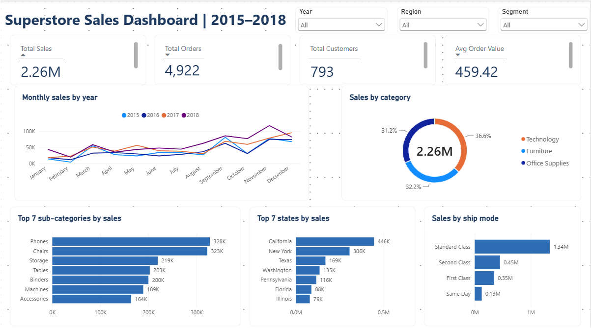

# Superstore Sales Analysis

End-to-end analysis of the Superstore sales dataset (2015-2018) using Python, SQL and Power BI, completed for the Internova Data Analytics Virtual Internship.



## Business questions
How do sales change over time? Which products, regions, segments and customers drive sales? How are orders shipped?

## Key findings
- Total sales of **2.26M** across **4,922 orders** and **793 customers**; average order value **459.42**
- Sales fell 4.2% in 2016, then grew **30.6%** (2017) and **20.3%** (2018)
- **September to December** produce 51.8% of annual sales; February is the weakest month
- **Phones and Chairs** make up 28.8% of sales
- **California and New York** produce 33.3% of sales; the South is the weakest region
- Customers are loyal: **98.4%** ordered more than once

> The source file has no profit, quantity or discount columns, so all results are based on sales.

## Tools
Python (pandas, matplotlib, seaborn), SQL (SQLite), Power BI

## Project structure
```
superstore-sales-analysis/
├── data/raw/ and data/processed/
├── notebooks/   01 cleaning, 02 exploratory analysis, 03 SQL analysis
├── sql/         schema and 11 analysis queries
├── dashboard/   Power BI file and screenshots
├── report/      final report (PDF)
└── images/      charts
```

## How to run
```bash
pip install -r requirements.txt
jupyter notebook
```
Run the notebooks in order (01, 02, 03). Notebook 03 builds the SQLite database from the cleaned CSV.

## Data cleaning summary
Dates converted from day/month/year text; 11 missing postal codes (Burlington, VT) filled; 1 duplicate row removed (9,799 rows remain); time features added.

## Report
See [report/Superstore_Final_Report.pdf](report/Superstore_Final_Report.pdf).

## Author

**Aicha Ajdid**

[LinkedIn](https://linkedin.com/in/aicha-ajdid) · [GitHub](https://github.com/AICHAAAAH)